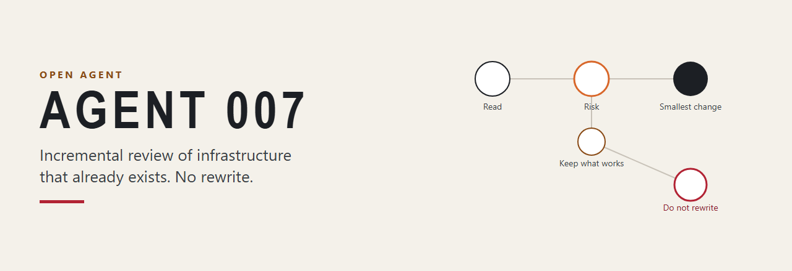

<p align="center">
  
</p>

<h1 align="center">Agent 007: incremental infrastructure review</h1>

<p align="center">
  <strong>Reads what already exists · Marks the risk · Proposes the smallest compatible change · Does not rewrite the system</strong>
</p>

<p align="center">
  <a href="https://github.com/Aixa11/agent-007-plus">Plus</a> ·
  <a href="./agent/rules.md">Rules</a> ·
  <a href="./examples">Examples</a> ·
  <a href="./LICENSE">License</a>
</p>

## What is Agent 007?

Agent 007 reviews infrastructure that already exists and already matters. It marks the risk and proposes the smallest change that still fits the system. It is not an engine that rewrites the repository.

The review happens in three steps:

1. **Read** the repository that is already there.
2. **Mark** the architectural, operational, and security risks a rule can point to.
3. **Propose** a compatible improvement and validate it locally before anyone applies it.

## Agent 007 Plus

The open release stays here, under Apache 2.0. Plus is the paid control plane: a supervisor the agent cannot switch off, an evaluation the author cannot grant itself, rule packs in layers, and a stop switch outside the sandbox.

The offer, the prices, and the license request live in a public repository that does not contain the product:

[Aixa11/agent-007-plus](https://github.com/Aixa11/agent-007-plus)

A payment does not unlock a folder. GitHub grants a whole repository or nothing. After the invoice is paid, the GitHub user is invited to exactly one private repository:

| License | Price | What opens |
| --- | --- | --- |
| Layers | 1,800 USD / year | Rule packs only. No runtime, no console, no isolation profiles. |
| Individual | 2,400 USD / year | The complete project, for one person. |
| Organization | 12,000 USD / year | The complete project for one entity, plus one new rule pack that year. |

Request a license from the offer repository. This README is the public door. It is not the checkout.

## Why it exists

Many AI coding assistants are optimized to generate code quickly, but not to preserve architectural continuity. In real systems, that often leads to oversized refactors, broken assumptions, and unnecessary operational risk.

Secure Architect Agent is designed to solve that problem by acting as an incremental architectural assistant rather than a replacement engine.

## Core principles

- Security by default.
- Data sovereignty.
- Incremental evolution.
- Compatibility with the existing pipeline.
- Local validation before applying changes.
- Clear reasoning for every recommendation.

## What it does

- Analyzes existing infrastructure or repositories.
- Identifies architectural, operational, and security risks.
- Proposes minimal, compatible improvements.
- Validates changes locally.
- Documents reasoning clearly.

## What it includes

- Agent rules.
- Reusable prompts and workflows.
- Reference blueprint.
- Policy baselines.
- Validation scripts and schema.
- Tests.
- Minimal examples.
- Publication-ready documentation.

## Project structure

- `agent/`: rules, prompts, and workflows.
- `blueprint/`: architectural reference and policy baselines.
- `validation/`: validation scripts, schema, and reports.
- `examples/`: minimal and real-world examples.
- `docs/`: vision, scope, and roadmap.
- `tests/`: checks for structure, rules, and validation behavior.

## Supported scenarios

- Incremental review of existing infrastructure.
- Security hardening.
- Compatibility-preserving refactors.
- Architecture summaries.
- Validation-oriented review.
- Documentation-driven adoption.
- Controlled modernization.

## Not supported

- Automatic full re-architecture.
- Unsafe destructive changes.
- Secret handling in the repository.
- Unbounded code generation.
- Vendor lock-in.
- Hidden assumptions.
- Full autonomous deployment.

## Examples

### Oil pipeline
A minimal example showing how the agent should review an existing critical infrastructure repository while preserving compatibility.

### Legacy modernization
A second example showing how the agent can improve a legacy platform incrementally without forcing a rewrite.

## Validation

Run one of the following from the repository root:

```powershell
pwsh -ExecutionPolicy Bypass -File .\validation\validate.ps1
python .\validation\validate.py
python -m pytest -q
```

## Getting started

1. Clone the repository.
2. Open it in VS Code.
3. Review `AGENTS.md` and `agent/rules.md`.
4. Run the validation task or script.
5. Review the examples and the supported scenarios.

## Contributing

Contributions are welcome when they respect the project philosophy:
- small and focused,
- easy to validate,
- compatible with the existing structure,
- and aligned with the security and sovereignty principles.

Read `CONTRIBUTING.md` before opening a pull request.

## Security

If you discover a security issue, please review `SECURITY.md` and report it privately.

## License

This project is licensed under the Apache License 2.0. See `LICENSE` for details.
